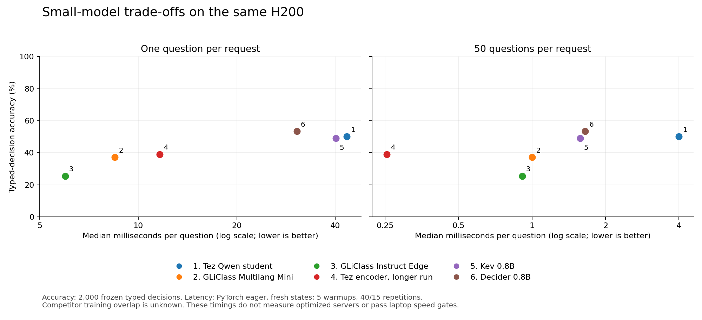

# Small-model comparison and improvement round

The Qwen student is competitive with Kev on typed decisions, but Decider is the stronger measured
general alternative. Decider leads the student on typed decisions, multilingual intent, six of
seven application tasks, and both SemIf suites. The student leads on routing and has lower raw
typed-decision calibration error. This evidence does not support a broad best-model claim.

| Model | Typed accuracy | MASSIVE-11 accuracy | H200 1-question median | H200 50-question median |
|---|---:|---:|---:|---:|
| Tez Qwen student | 50.15% | 64.09% | 43.42 ms | 200.12 ms |
| Kev 0.8B, native eager | 49.10% | 61.27% | 40.16 ms | 78.72 ms |
| Decider 0.8B, native eager | 53.40% | 74.45% | 30.53 ms | 82.61 ms |
| GLiClass Multilang Mini | 37.20% | 62.18% | 8.48 ms | 50.10 ms |
| Tez encoder, longer run | 39.05% | 51.73% | 11.64 ms | 12.71 ms |

These timings use the same H200 and fresh-state protocol. They do not measure the competitors'
optimized servers or satisfy the laptop speed gate. Laya's specialized typed-decisions checkpoint
scores 76.65% on typed decisions after training on that dataset's training split; Tez students
excluded the whole dataset. Upstream training overlap for the new competitors is not established.
The [full comparison](COMPARISON.md) preserves every task, calibration result, and evidence limit.

The paired state-bootstrap interval for Decider minus the Qwen student is **+1.20 to +5.20 accuracy
points**, around an observed +3.25. Kev minus the student is **−3.65 to +1.55 points**; that result
does not establish a clear winner. These are exploratory intervals without multiplicity adjustment.
The original public test has informed this research direction; fresh confirmation is still needed.

## What improved, and what did not

The encoder trained for 12 epochs, selecting epoch 10 solely by minimum teacher-validation KL.
Validation agreement rose from 76.19% to 78.99%, and KL fell from 0.1622 to 0.1438. Typed accuracy
rose from 35.95% to 39.05%, while MASSIVE fell from 52.73% to 51.73%. This candidate still misses
the quality targets and is not promoted. Its packed accuracy is 0.15 points above separate-question
evaluation. Training took 572.6 seconds, excluding loading, final calibration, and export.

Three Qwen speed candidates were tested without changing the trained adapter:

| Candidate | Probability check on 1,390 validation decisions | Speed evidence | Decision |
|---|---|---|---|
| Merge LoRA into bf16 weights | Failed maximum difference and mean total variation limits | Faster in this H200 run | Reject under registered parity criteria |
| Disable unused cache | Exact agreement, including all probabilities | 53.66 ms for one question; 248.13 ms for 50, slower than the control | Keep original configuration |
| Raise inference batch from 16 to 64 | Narrowly failed: maximum difference 0.040981 > 0.04; mean TV 0.0050033 > 0.005 | Not timed after parity failed | Keep original configuration |

No tolerance was relaxed after seeing a result. These variants remain experimental; runtime behavior
and the original model files were not changed.

The [laptop run](../pilot-laptop-20260927/README.md) completed four-thread CPU timing of the small
encoder. All three GPU attempts failed the original cooling requirement before timing. GPU speed
promotion remains pending; cloud timings cannot substitute for it.

## Next research direction

The [state audit](state_structure_audit.json) found no nested states among 5,998 training examples,
versus nested data in all 400 typed-decision test states. The [token audit](encoder_input_audit.json)
found no evaluation truncation. Structured training coverage is therefore a better-supported next
hypothesis than increasing context length, although causation has not been established.

The next controlled round should compare newly authored structured training examples with the
current flat-text mixture, keep test examples out of generation and fitting, and use Decider as a
released-model baseline. Model selection and probability calibration need a separate representative
validation set; the existing public benchmark should remain a secondary regression check. Reusing
the stronger released model is a valid outcome. The current small encoder is not ready to replace it.

A subsequent [fixed equal-probability blend](ENSEMBLE.md) of the Qwen student and Decider scored
53.00% on typed decisions, versus Decider's 53.40%. The paired state-bootstrap interval for the
difference spans -1.85 to +0.95 points. MASSIVE-11 rose from 74.45% to 74.91%. This exploratory
analysis does not establish a useful overall gain, and both models would still require inference.
No serving change was made. The completed [paired structure diagnostic](../pilot-structure-probe-20260927/README.md)
weakens nesting alone as an explanation: both encoders improved on nested versions of identical facts,
while Qwen lost 1.67 points. All three models always chose the middle ordinal band, scoring 33.33%,
and Qwen always answered true to the numeric threshold question. Qwen's lookup and explicit
missing-value accuracy were both 100%. The next diagnosis should distinguish answer-position and
score-type cues from missing reasoning coverage before investing in another training run. These
synthetic diagnostic scores do not replace the original gates or establish generalization.

## Validation, artifacts, and cost

Seven new complete evaluations each contain 6,151 decisions across 21 tasks: **43,057 validated
primary predictions**. Every decision ID, gold label, finite normalized probability vector, argmax,
and aggregate accuracy was checked against the frozen input. The downloaded encoder's weights
match the evaluated weight hashes. All 266 exported files passed checksum verification.

The original training download failure and the failed optimization checks are retained. The
predictor factory's module identity initially skipped the encoder's separate-question diagnostic;
it was measured separately using the same weights and appended without altering primary predictions.
The source fix prevents this omission in later runs. Windows GPU-memory label handling and unknown
thermal telemetry were also corrected. The offline pilot suite has 52 passing tests, and changed
Python files pass Ruff.
The broader research directory still reports seven pre-existing lint findings in unchanged files;
this round does not claim a clean full-directory lint run.

The H200 Pod was **terminated**, its absence verified, and its local stop watcher stopped. This
round cost an estimated **$2.90**, bringing all RunPod trials to **$9.15 of the authorized $10**.
These are elapsed-time estimates using the authenticated rate and running storage, not a settled
provider invoice. No paid Pod remains from this work.

The [measurement archive](measurement-artifacts.tar.gz) retains prediction rows, logs, environment,
executed source snapshots, and input manifests. See its [download receipt](artifact_download.json),
[per-file manifest](artifact_manifest.json), [result validation](results_validation.json),
[model export receipt](model_export.json), and [compute receipt](compute_receipt.json).
The trained model is under `runs/improvement-artifacts-h200-20260927/runs/student-data/models/a-base-12ep/`;
model binaries and teacher training data are not committed.

[Vector figure](quality_speed.svg). The broader research goal remains open: the original quality
and laptop speed criteria have not all been met.
